# Design and Verification of a Configurable UART IP Core in Verilog with SVA and Yosys Synthesis

[](https://github.com/Srishanth6/Configurable-UART-IP-Core/actions/workflows/ci.yml)

## Overview

This project implements a UART IP core in Verilog, written from scratch, with:

- a 16x oversampling baud generator, TX and RX with optional parity;
- four optional features selected by parameters (auto-baud, Hamming SECDED, low-power clock enables, line-quality monitor);
- self-checking randomized SystemVerilog testbenches and SVA assertions run in Verilator, including injected-bug tests;
- Yosys generic and iCE40 synthesis with a nextpnr Fmax estimate.

All numbers below are copied from the logs in [`logs/`](logs). The full write-up is in [report/UART_IP_Core_Report.pdf](report/UART_IP_Core_Report.pdf).

## Features and Parameters

**Core**
- 16x oversampling baud generator with a runtime-programmable divisor (`DIV_W` bits)
- TX with no, even or odd parity, plus `tx_busy` and a `tx_done` pulse
- RX with a 2-flop synchronizer, mid-bit sampling, start-bit glitch rejection, `parity_err`, `frame_err` and a one-cycle `rx_valid`

**Optional features** (`*_EN` parameters; a disabled feature is not synthesized at all)

| Parameter | Feature |
|---|---|
| `AUTOBAUD_EN` | Auto-baud. Measures 8 bit-times of a 0x55 sync character and sets the divisor to `(T+64)>>7` |
| `ECC_EN` | Hamming SECDED(13,8) sent over two frames. Corrects 1-bit errors and detects 2-bit errors |
| `LOWPWR_EN` | Clock-enable gating of the baud counters, waking on the start edge |
| `LINEMON_EN` | Line-quality monitor: error counters, bit-timing drift (1/16 bit), health score 0-100 |

### Parameters and ports (`uart_core`)

| Parameter | Default | Range / meaning |
|---|---|---|
| `DIV_W` | 16 | divisor width; tested 8 and 16 (synthesis), divisor 1..65535 in sim (`make edge`) |
| `PARITY_SUPPORT` | 1 | 0 removes parity logic (`parity_mode` ignored) |
| `AUTOBAUD_EN`, `ECC_EN`, `LOWPWR_EN`, `LINEMON_EN` | 0 | 1 enables the feature |

| Port | Dir | Width | Description |
|---|---|---|---|
| `clk`, `rst_n` | in | 1 | clock, async active-low reset |
| `divisor` | in | `DIV_W` | clocks per 1/16 bit = f_clk/(16*baud), must be >= 1 (checked by SVA B4) |
| `parity_mode` | in | 2 | 00 none, 01 even, 10 odd, 11 none |
| `tx_start`, `tx_data` | in | 1, 8 | byte accepted when `tx_start` and TX idle |
| `tx`, `tx_busy`, `tx_done` | out | 1 | serial out (idle high), frame in progress, 1-clock end pulse |
| `rx` | in | 1 | serial in (2-flop synchronised) |
| `rx_data`, `rx_valid`, `parity_err`, `frame_err` | out | 8,1,1,1 | received byte, 1-clock pulses |
| `abd_start` / `abd_busy`, `abd_locked`, `abd_err` | in / out | 1 | auto-baud control/status |
| `div_active` | out | `DIV_W` | divisor in use (auto-baud result once locked) |
| `ecc_corr`, `ecc_uncorr` | out | 1 | SECDED corrected / uncorrectable flags |
| `mon_clr` / `mon_frames`, `mon_parity`, `mon_framing`, `mon_corr`, `mon_uncorr` | in / out | 1 / 16 | line-monitor clear and counters |
| `mon_drift_last`, `mon_drift_max`, `mon_health` | out | 5 (signed), 4, 7 | bit-edge drift (1/16 bit) and health 0-100 |

## Architecture

```
            divisor / div_active (auto-baud)
                    |
         +----------+-----------+
         |                      |
   uart_baud_gen (TX)     uart_baud_gen (RX)      LOWPWR_EN: en gated by busy
         | tx_tick              | rx_tick
 tx_start/tx_data          rx --+--> [ABD mux] --> uart_rx --> rx_data/rx_valid
   --> [ECC_EN: uart_ecc_tx]                        |  parity_err/frame_err
   --> uart_tx --> tx                   [ECC_EN: uart_ecc_rx + secded_dec]
                                        [LINEMON_EN: uart_linemon -> mon_*]
                   [AUTOBAUD_EN: uart_autobaud measures 0x55 -> abd_div]
```

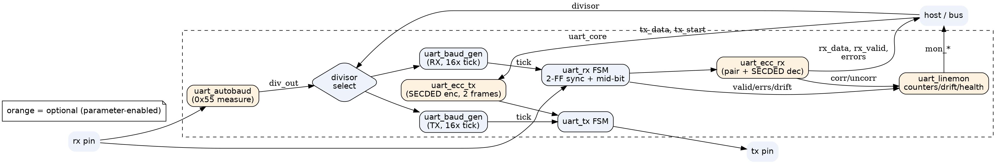

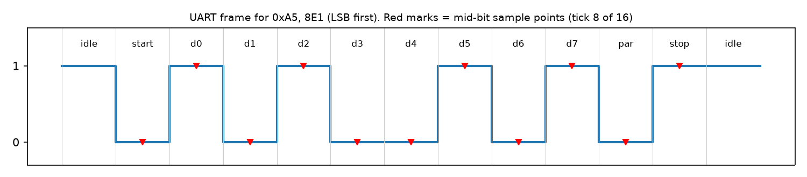

### TX FSM
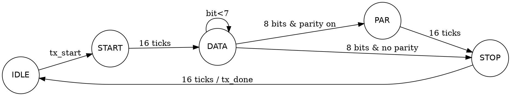

### RX FSM
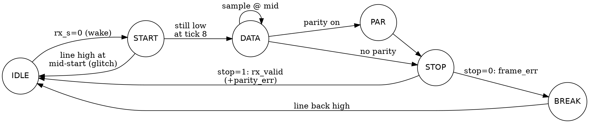

### Auto-baud FSM
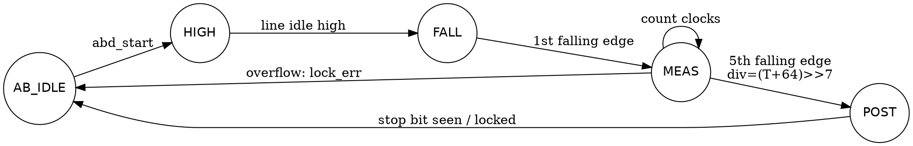

## Project Structure

```text
Configurable-UART-IP-Core/
├── .github/workflows/ci.yml   # GitHub Actions: builds Verilator 5.032, runs make all
├── rtl/                       # Verilog design (uart_core.v is the top)
│   ├── uart_core.v
│   ├── uart_baud_gen.v
│   ├── uart_tx.v
│   ├── uart_rx.v
│   ├── uart_autobaud.v
│   ├── uart_ecc_tx.v / uart_ecc_rx.v
│   ├── uart_secded_enc.v / uart_secded_dec.v
│   └── uart_linemon.v
├── sva/
│   ├── uart_sva.sv            # A1-A12
│   └── uart_sva_ext.sv        # B1-B4
├── tb/
│   ├── tb_baud.v, tb_loopback.v, tb_power.v          # Icarus Verilog
│   └── tb_uart_rand.sv, tb_features.sv, tb_edge.sv   # Verilator
├── scripts/                   # vbuild.sh, neg_tests.sh, synth_all.sh, vcd_toggles.py, err_waves.py, gtkwave_shots.sh
├── waves/                     # small VCDs and GTKWave save files (*.gtkw)
├── syn/out/                   # Yosys stats per configuration
├── logs/                      # every log the results come from
├── report/                    # report (.md/.docx/.pdf), figures and generator scripts
├── Makefile
└── README.md
```

## Simulation and Verification

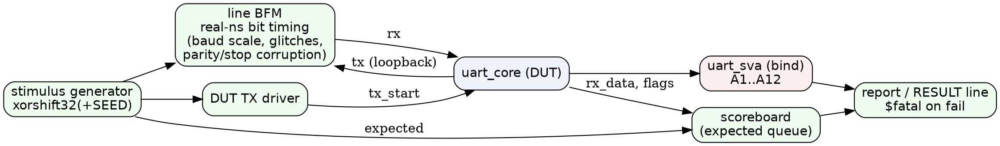

| Test | Result | Log |
|---|---|---|
| Baud generator tick period (divisors 4/27/163/326, plus clr) | 201 checks, 0 errors | `logs/baud_gen.log` |
| Loopback: 256 bytes × none/even/odd parity | **772/772 PASS** | `logs/loopback.log` |
| Random TB, seeds 1, 42, 2026 (base config) | **12/12 groups PASS** for each seed | `logs/rand_seed*.log` |
| Random TB, same seeds, `LOWPWR_EN=1 LINEMON_EN=1` | **12/12 PASS** for each seed | `logs/rand_lp_mon_seed*.log` |
| Feature TB, 3 seeds × 50/100/133.3 MHz | **9/9 runs PASS** | `logs/features_seed*_clk*.log` |
| Edge cases, divisor = 1, 2, 3, 16, 255 (full set) and 65535 (back-to-back only) | **6/6 runs PASS** | `logs/edge_div*.log` |
| Negative tests (4 injected bugs) | **All 4 caught by SVA**, exit code 134 | `logs/negative_tests.log` |

Edge-case testbench `tb/tb_edge.sv` (added after review), groups per run:
- E1 divisor boundary values: 1, 2, 3, 16, 255, 65535 (the 16-bit maximum);
- E2 reset asserted in every TX state (START, DATA, PARITY, STOP), then a good frame must follow;
- E3 reset asserted in every RX state (START, DATA, PARITY, STOP, BREAK), no byte may come out, then recovery;
- E4 back-to-back frames (`tx_start` held) in all four `parity_mode` codes 00/01/10/11;
- E5 malformed frames: start glitches of 1 clock up to just under half a bit (rejected), bad stop bit in all four parity codes (`frame_err`, no `rx_valid`), wrong parity bit for even and odd.

### Assertions

 `sva/uart_sva.sv` has A1-A12 (TX idle/frame length/done/start bit, RX pulses and error flags, low-power, ECC, auto-baud, monitor). `sva/uart_sva_ext.sv` adds:
- **B1** baud timing: every tick comes exactly `divisor` clocks after the previous one (B1b: never later);
- **B2** RX mid-bit sampling: start bit sampled 8 ticks after detection, data bit n at 8+16(n+1) ticks;
- **B3** reset: TX/RX FSMs idle, `tx`=1 and no `rx_valid`/`parity_err`/`frame_err` while reset is held and at release;
- **B4** parameter/divisor boundaries: `DIV_W` in 1..32 at elaboration, `divisor != 0` at run time.

Antecedent hit counts are printed in every log (e.g. DIV=16: B1 29,873, B2 start 160, B2 data 1,240, B3 13 reset cycles).

The random TB (seed 1) covers:
- 3000 random frames;
- 500 back-to-back frames;
- parity and stop-bit error injection;
- ±2% and ±3% baud mismatch with 0 bad frames;
- ±8% baud mismatch, where 281 and 278 of 300 frames had errors, as expected;
- start-bit glitch rejection;
- 50 resets in the middle of a frame.

### Injected-bug (negative) tests
- `+define+INJECT_BUG` stretches `rx_valid` to 2 cycles. It was caught by **A5** at 69.55 µs.
- `+define+INJECT_BUG_TX` makes the stop bit one tick short. It was caught by **A2**: "tx_busy length 2544, expected 2560".
- `+define+INJECT_BUG_BAUD` makes the baud counter off by one. It was caught by **B1b** at 330 ns: "no baud tick for 5 clocks (divisor=4)".
- `+define+INJECT_BUG_RXMID` starts RX sampling 3/16 bit late. It was caught by **B2** at 1.11 µs: "start bit sampled at tick 11, expected 8".

## Run on Linux / macOS

Requirements: Verilator 5.032 (the version all logs were made with), Icarus Verilog 12, Yosys 0.5x, Python 3 with matplotlib and python-docx, Graphviz, and LibreOffice (only for the PDF). nextpnr-ice40 is optional (Fmax column).

Every target creates `build/`, `logs/` and `waves/` itself, so a fresh clone works with `make all`. If your `python3` has no matplotlib, use `make all PYTHON=/path/to/python3`.

```bash
make baud loopback        # iverilog tests
make rand rand_feat       # randomized TB (SEEDS="1 42 2026" by default)
make neg                  # injected-bug tests; the assertions must fire
make features             # auto-baud / ECC / monitor at 3 clocks
make power                # VCD toggle-count proxy
make edge                 # divisor limits, reset in every state, parity codes, bad frames
make waves_err            # traced run -> TX/RX, parity and framing error plots
make bug_demo             # injected RXMID bug, B2 must fire; writes waves/tb_edge_bug_rxmid.vcd
make gtkwave_shots        # GTKWave screenshots -> report/figs/gtkwave_*.png (needs X / xvfb-run)
make synth                # Yosys + nextpnr table -> logs/synth_summary.log
make all                  # everything above except report
make report               # figures + PDF
```

CI (`.github/workflows/ci.yml`) installs the tools on Ubuntu 24.04 and runs the same targets on every push. Ubuntu 24.04's apt Verilator is 5.020, so CI builds Verilator v5.032 from source once, caches it, and fails if `verilator --version` is not 5.032.

## Run on Windows

1. Install Icarus Verilog (which includes GTKWave) and make sure `iverilog`, `vvp` and `gtkwave` are on PATH.
2. From the repository root (Command Prompt or PowerShell):

   ```bat
   mkdir build logs
   iverilog -g2012 -o build/tb_loopback tb/tb_loopback.v rtl/*.v
   vvp -n build/tb_loopback
   gtkwave waves/tb_loopback.vcd waves/loopback.gtkw

   iverilog -g2012 -P tb_power.LP=1 -o build/tbp1 tb/tb_power.v rtl/*.v
   vvp -n build/tbp1
   gtkwave waves/power_lp1.vcd waves/lowpower.gtkw

   iverilog -g2012 -o build/tb_baud tb/tb_baud.v rtl/*.v
   vvp -n build/tb_baud
   ```

The loopback run should print `LOOPBACK_TEST frames_checked=772 pass=772 fail=0 -> PASS`. The Verilator testbenches (`tb_uart_rand`, `tb_features`, `tb_edge`) and the SVA files need Verilator 5.032 and the Makefile, so run them on Linux or WSL. Saved VCDs from those runs (for example `waves/tb_edge_bug_rxmid.vcd`) can still be opened in GTKWave on Windows.

## Waveforms

### Waveforms (from `waves/tb_loopback.vcd`)
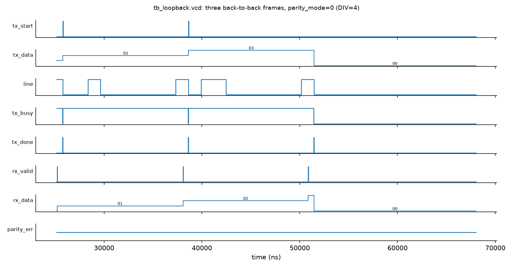
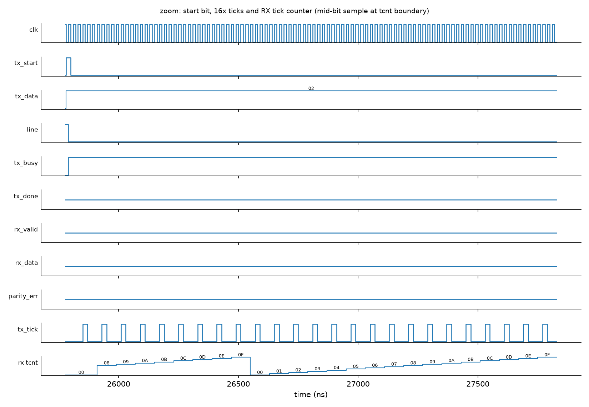

### Error waveforms (from `waves/tb_edge_err.vcd`, `make waves_err`, DIV=4)
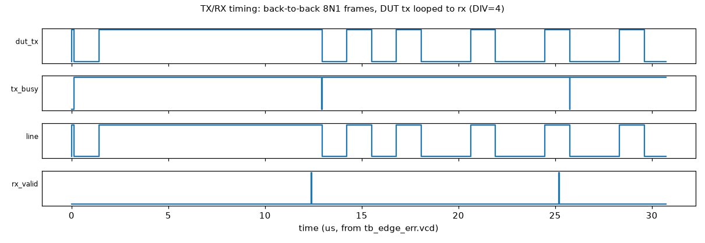
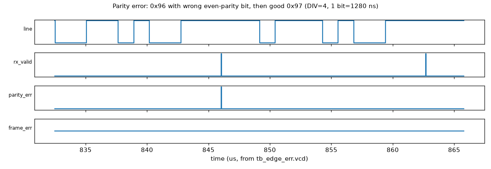
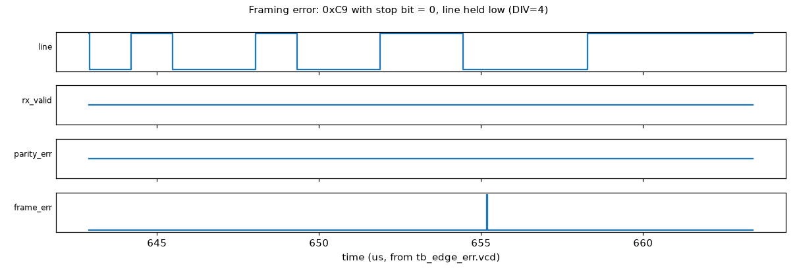

### GTKWave screenshots

These are real screenshots of GTKWave 3.3.121 with the saved VCDs open, not plots. Each view has a save file in `waves/` (signals, hex radix for buses, zoom and marker), so it can be reopened with `gtkwave <vcd> <gtkw>`. `make gtkwave_shots` regenerates the VCDs and the screenshots (it needs an X display, or run it under `xvfb-run`). `waves/tb_edge_err.vcd` is not committed (8.7 MB); `make waves_err` recreates it.

| View | Open with | Window, marker |
|---|---|---|
| TX/RX loopback | `gtkwave waves/tb_loopback.vcd waves/loopback.gtkw` | 0-27 µs, marker 12.39 µs (first rx_valid) |
| Parity error | `gtkwave waves/tb_edge_err.vcd waves/parity_err.gtkw` | 832.51-865.80 µs, marker 846.05 µs (parity_err with rx_valid, rx_data=96) |
| Framing error | `gtkwave waves/tb_edge_err.vcd waves/frame_err.gtkw` | 642.91-663.40 µs, marker 655.17 µs (frame_err, no rx_valid) |
| Low power (LOWPWR_EN=1) | `gtkwave waves/power_lp1.vcd.gz waves/lowpower.gtkw` | 0-2.2 ms, marker 1995.98 µs (next frame starts) |
| Injected bug RXMID | `gtkwave waves/tb_edge_bug_rxmid.vcd waves/bug_rxmid.gtkw` | 0-1.12 µs, marker 1.10 µs |

The injected-bug run (`make bug_demo`, `logs/bug_demo.log`) stops at 1.11 µs with *"B2 start bit sampled at tick 11, expected 8"*. The VCD's last dumped time is 1.10 µs, so the marker is placed there. In the screenshot, `rx_tcnt` is loaded with 5 instead of 8 when the start bit is detected (see `rtl/uart_rx.v`), which is the injected bug.

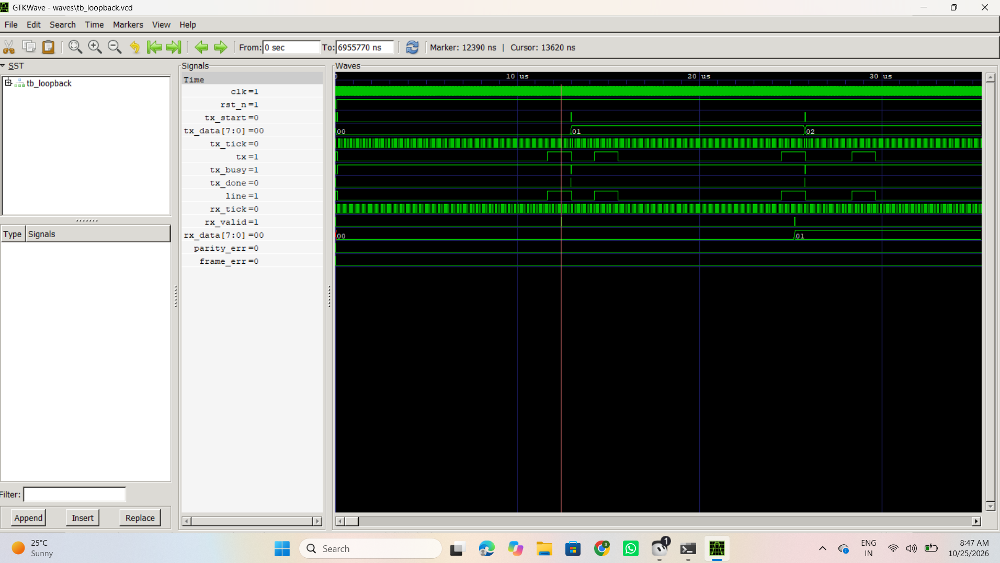

*Figure G1: GTKWave on Windows 11, TX/RX loopback; simulated with Icarus Verilog 12 on Windows (tb_loopback.vcd).*

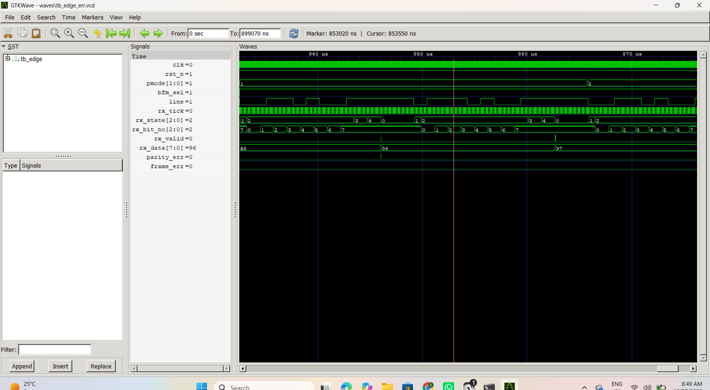

*Figure G2: GTKWave on Windows 11, parity error (tb_edge_err.vcd, simulated with Verilator 5.032 on Linux).*

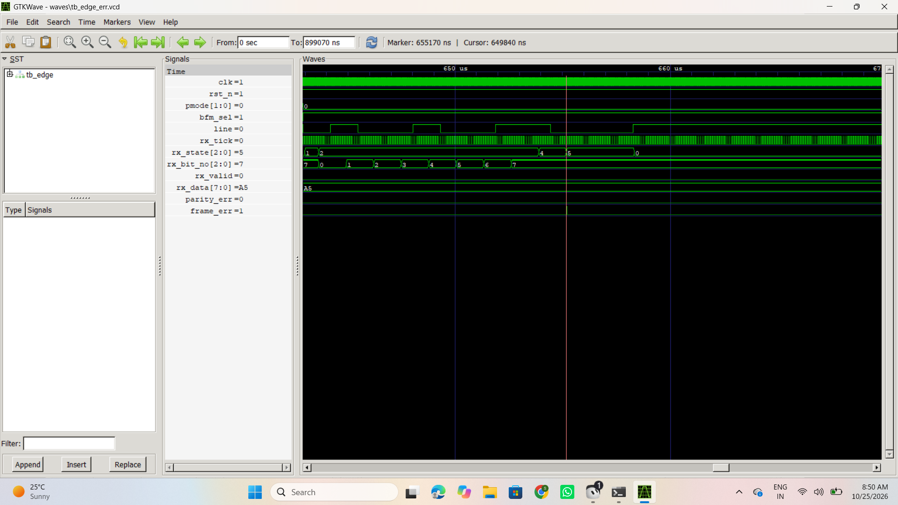

*Figure G3: GTKWave on Windows 11, framing error (tb_edge_err.vcd, simulated with Verilator 5.032 on Linux).*

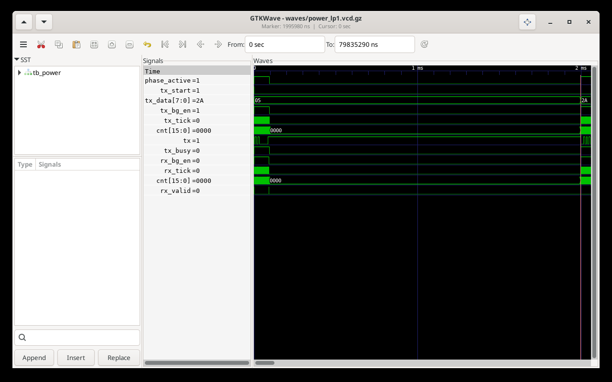

*Figure G4: GTKWave on Windows 11, low-power mode: baud counters stop between frames; simulated with Icarus Verilog 12 on Windows (power_lp1.vcd).*

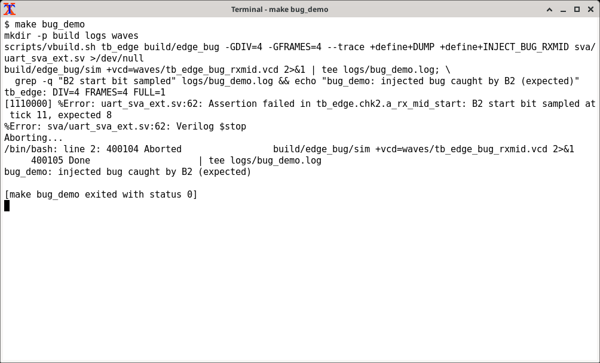

*Figure G5: terminal running `make bug_demo`; the SVA error from B2.*

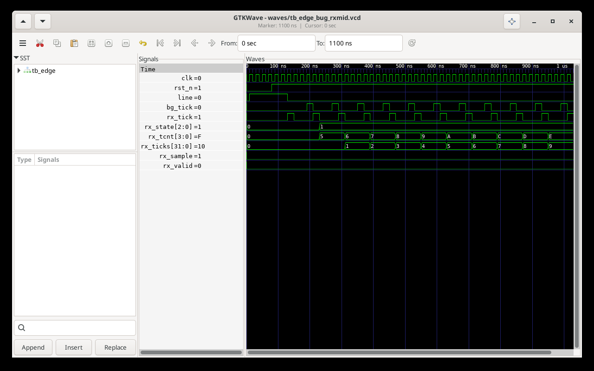

*Figure G6: GTKWave on Windows 11 at the B2 failure (tb_edge_bug_rxmid.vcd, simulated with Verilator 5.032 on Linux).*

## Feature Results

**Auto-baud.** The test locks on 0x55 and then checks the bytes that follow. The locked divisor is always the nearest integer to the ideal value.

| Clock | Baud | Locked div | Rate error | Bytes OK |
|---|---|---|---|---|
| 50 MHz | 2400 | 1302 | +0.01% | 10/10 |
| 50 MHz | 115200 | 27 | +0.47% | 40/40 |
| 50 MHz | 460800 | 7 | -3.12% | 40/40 |
| 50 MHz | 921600 | 3 | +13.03% | 0/40 (divisor too coarse) |
| 133.3 MHz | 921600 | 9 | +0.47% | 40/40 |

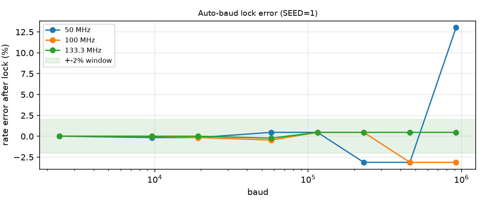

**SECDED.** 1500 random bytes per seed, with random flips on the line.

| Seed | Clean | 1-bit corrected | 2-bit detected | Wrong data |
|---|---|---|---|---|
| 1 | 589/589 | 621/621 | 290/290 | 0 |
| 42 | 606/606 | 602/602 | 292/292 | 0 |
| 2026 | 607/607 | 609/609 | 284/284 | 0 |

**Low power.** VCD toggle count, used only as an activity proxy. This is not a power measurement, and the clock is excluded.

| Config | Idle toggles | Active toggles |
|---|---|---|
| `LOWPWR_EN=0` | 15,206,486 | 802,085 |
| `LOWPWR_EN=1` | 127 | 777,894 |

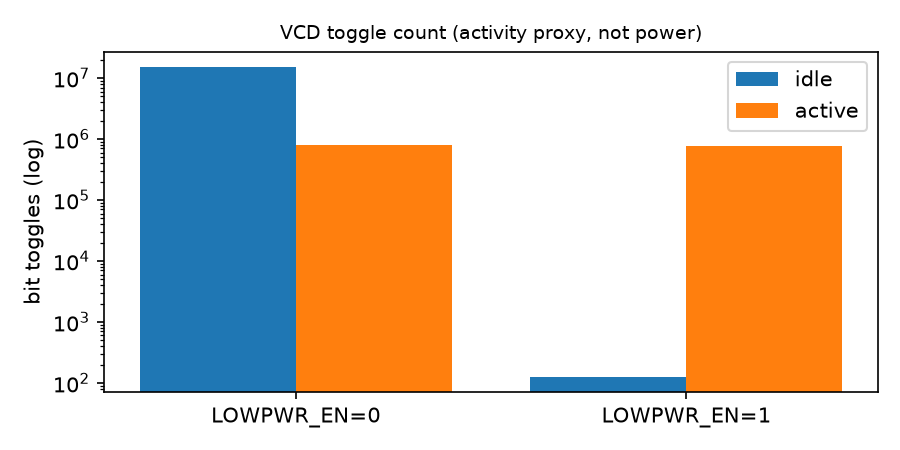

**Line monitor** (seed 1, 50 MHz)

| Scenario | Framing errors | Max drift (1/16 bit) | Health |
|---|---|---|---|
| Clean | 0 | 1 | 100 |
| +2% baud | 0 | 2 | 100 |
| +3% baud | 0 | 4 | 84 |
| +6% baud | 57 | 7 | 0 |

In the noise test, the monitor counters matched the injected errors exactly (45 parity and 26 framing errors for seed 1).

## Generic Synthesis Comparison

All feature configs use `DIV_W=16 PARITY_SUPPORT=1`, so each row differs from *Base, DIV_W=16* only by the feature(s) named.

| Config | Generic cells | Generic flops | Logic depth (gates) | iCE40 LUT4 | iCE40 DFF | Fmax (MHz, nextpnr) |
|---|---|---|---|---|---|---|
| Base, `DIV_W=16` | 889 | 88 | 25 | 174 | 88 | 141.78 |
| Base, `DIV_W=8` | 621 | 72 | 17 | 116 | 72 | 142.78 |
| Base, no parity | 809 | 82 | 25 | 167 | 82 | 124.60 |
| + auto-baud | 1327 | 139 | 31 | 286 | 139 | 73.92 |
| + ECC | 1426 | 151 | 28 | 271 | 151 | 128.52 |
| + low power | 814 | 88 | 28 | 198 | 88 | 126.25 |
| + line monitor | 1532 | 172 | 27 | 311 | 172 | 75.71 |
| All features | 2698 | 318 | 31 | 585 | 318 | 73.87 |

What each column is:
- **Generic cells / flops**: Yosys `synth -flatten; abc -g cmos2` internal gates. Not a real cell library, no area.
- **Logic depth**: longest combinational path counted in gates (`ltp -noff`). It is not a delay.
- **iCE40 LUT4 / DFF**: `synth_ice40` technology mapping.
- **Fmax**: nextpnr-ice40 post-place-and-route estimate for iCE40 HX8K (ct256), seed 1, I/O pins unconstrained. It is the only real timing number; no ASIC STA was done. If nextpnr is not installed the script prints `not_measured`.
- The ECC, line-monitor and all-features rows changed slightly from the first version (e.g. all features 2720 -> 2698 cells, ECC 276 -> 271 LUT4) after setting `DIV_W`/`PARITY_SUPPORT` explicitly with `chparam`; this table is the current `logs/synth_summary.log`. The report (md/docx/pdf) was regenerated with these numbers.

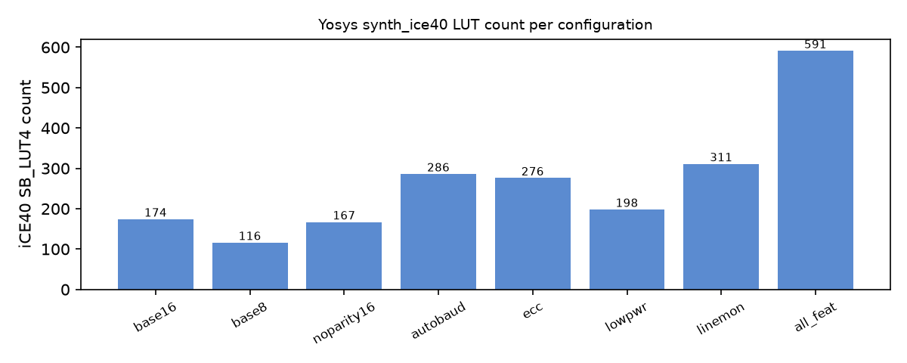

### Interpretation

- The base core (`DIV_W=16`) maps to 174 LUT4 and 88 DFF on iCE40, with a nextpnr estimate of 141.78 MHz.
- Narrowing the divisor to `DIV_W=8` cuts generic cells from 889 to 621 and logic depth from 25 to 17 gates.
- Auto-baud and the line monitor are the most expensive features (286 and 311 LUT4) and lower the Fmax estimate to 73.92 and 75.71 MHz.
- With all features enabled the core uses 585 LUT4 and 318 DFF, with an Fmax estimate of 73.87 MHz.
- Cell counts and logic depth are generic Yosys statistics, not area or delay. Only the Fmax column is a timing number, and it is a place-and-route estimate.

## Limitations

- Supports 8 data bits and 1 stop bit only, with no FIFO or flow control.
- Auto-baud accuracy is limited by the integer divisor at high baud-to-clock ratios.
- ECC halves the throughput, and a lost frame drops the byte (it is flagged, not recovered).
- The power numbers are an RTL toggle-count proxy, not a real power estimate.
- Verification is simulation only: no formal proofs, gate-level simulation or hardware test.
- Fmax is an iCE40 place-and-route estimate with unconstrained pins, not a board-level result; there is no ASIC timing.
- The 65535 divisor run checks back-to-back frames only (the full edge set would take too long at that rate).
- CI runs on GitHub Actions (Ubuntu 24.04); Windows runs have only been done for the Icarus testbenches.
- The health score formula is my own heuristic.

## Key Takeaways

- Built a parameterized UART core whose optional features are not synthesized when disabled.
- Loopback passed 772/772 checks, and the random, feature and edge-case Verilator runs all passed (logs committed).
- All four injected bugs were caught by the SVA assertions, which shows the assertions can fail.
- Synthesis shows the cost of each feature: from 174 LUT4 for the base core to 585 LUT4 with all features.

## Future Work

- Add FIFOs, flow control (RTS/CTS), and configurable data bits and stop bits.
- Add formal property checking of the SVA assertions (for example with SymbiYosys).
- Run gate-level simulation and test the core on an iCE40 board.
- Run ASIC synthesis with a standard-cell library and static timing analysis.

## Resume / LinkedIn Description

Designed a configurable UART IP core in Verilog with a 16x oversampling baud generator, parity, and optional auto-baud, Hamming SECDED, low-power and line-monitor features. Verified it with self-checking randomized SystemVerilog testbenches and SVA assertions in Verilator, including injected-bug tests, and compared feature cost with Yosys and nextpnr-ice40 synthesis.

## License

Student project for educational and portfolio demonstration. No licence specified.
