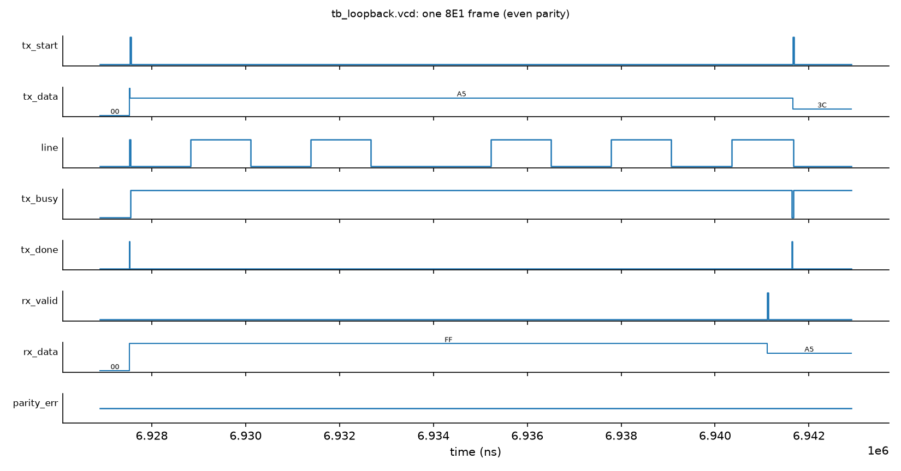
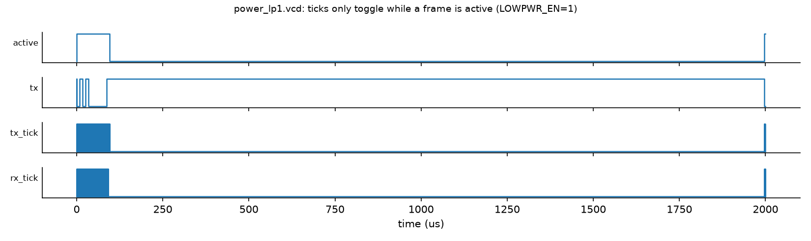

# Design and Verification of a Configurable UART IP Core

**Author:** Srishanth, ECE, CBIT  
**Tools:** Verilator 5.032, Icarus Verilog 12, Yosys 0.52, Python/matplotlib, Graphviz  
**Date:** October 2026

## Abstract

This report covers a UART IP core that I wrote from scratch in Verilog and verified with self-checking testbenches. The core has a runtime-programmable 16x oversampling baud generator, a transmitter with none/even/odd parity, and a receiver. The receiver has a two-flop synchronizer, mid-bit sampling, start-bit glitch rejection, and parity and framing error flags. On top of this I added four optional, parameter-enabled features:

- auto-baud detection from a 0x55 sync character;
- Hamming SECDED(13,8) protection spread over two frames;
- a low-power mode that clock-enables the baud counters and wakes on a start edge;
- a line-quality monitor with error counters, bit-timing drift and a 0-100 health score.

Verification uses directed and randomized SystemVerilog testbenches with fixed seeds, a scoreboard, and 12 SVA properties checked by Verilator with `--assert`. Two deliberately injected RTL bugs are caught by the assertions. Every test listed in this report passed, and the logs are in `logs/`. Yosys gives cell counts and logic depth for eight parameter configurations. Every number here comes from a log file in the project. Nothing is estimated.

## 1. Introduction to UART

A UART sends bytes serially without a shared clock. Both sides agree on a baud rate in advance. The line idles high, and each frame looks like this:

- one **start bit** (0);
- **8 data bits**, LSB first;
- an optional **parity bit** (even or odd);
- one **stop bit** (1).

The receiver detects the falling edge of the start bit. It then samples each bit near its middle, which leaves about ±50% of a bit of timing margin. Across a whole frame this works out to roughly ±4-5% total baud mismatch. In practice the safe figure is quoted as ±2% per side.


*Figure 1: Frame format (0xA5, 8E1) with the mid-bit sample points used by my receiver.*

## 2. Architecture


*Figure 2: Top-level block diagram of `uart_core` (generated with Graphviz from report/figs/block.dot).*

The TX and RX have separate baud generators. This lets the low-power mode stop one without the other, and it lets the receiver re-phase its counter on every start bit. Each optional block sits in a `generate if (X != 0)` section. When a feature is off, its logic is not elaborated at all, which section 7 confirms.

### 2.1 Parameters and interface

| Parameter | Default | Meaning |
|---|---|---|
| DIV_W | 16 | width of the runtime baud divisor |
| PARITY_SUPPORT | 1 | 0 removes the parity hardware entirely |
| AUTOBAUD_EN | 0 | auto-baud block from a 0x55 sync character |
| ECC_EN | 0 | SECDED(13,8) over two frames |
| LOWPWR_EN | 0 | clock-enable gating of baud counters, wake on start edge |
| LINEMON_EN | 0 | line-quality monitor |

| Port | Dir | Description |
|---|---|---|
| clk, rst_n | in | clock, active-low async reset |
| divisor[DIV_W-1:0] | in | clocks per 1/16 bit (tick period) |
| parity_mode[1:0] | in | 0 none, 1 even, 2 odd |
| tx_start, tx_data[7:0] | in | start a frame (accepted when not busy) |
| tx, tx_busy, tx_done | out | serial out, busy flag, 1-cycle done pulse |
| rx | in | serial in (asynchronous) |
| rx_data[7:0], rx_valid | out | received byte + 1-cycle valid pulse |
| parity_err, frame_err | out | parity error (with rx_valid), framing error (no rx_valid) |
| abd_start / abd_busy / abd_locked / abd_err, div_active | in/out | auto-baud control, status and the divisor in use |
| ecc_corr, ecc_uncorr | out | single-bit corrected / double-bit detected |
| mon_clr, mon_frames, mon_parity, mon_framing, mon_corr, mon_uncorr | in/out | monitor counters (16-bit, saturating) |
| mon_drift_last, mon_drift_max, mon_health | out | edge drift in 1/16 bit, health 0-100 |

## 3. Module design

### 3.1 Baud generator (`uart_baud_gen.v`)

The baud generator is a counter that runs from 0 to `divisor-1` and gives a one-clock `tick`. The tick rate is 16 times the baud rate, so `divisor = f_clk / (16 * baud)`. For 50 MHz and 115200 baud this is 27.13, which rounds to 27 (+0.47% error).

There are two control inputs:

- `clr` re-phases the counter. The RX uses it on a start edge.
- `en` freezes the counter. Low-power mode uses it.

**Check:** `tb_baud.v` measured the tick period for divisors 4, 27, 163 and 326 over 50 periods each, and also checked `clr`. Result: 201 checks, 0 errors (`logs/baud_gen.log`).

### 3.2 Transmitter (`uart_tx.v`)


*Figure 3: TX state machine.*

The TX has five states: IDLE, START, DATA, PAR and STOP. Every bit lasts 16 ticks. The parity bit is the XOR of the data, inverted for odd parity. When `tx_start` is accepted, the byte and the parity mode are latched, so changing the inputs mid-frame does nothing. `tx_busy` is simply `state != IDLE`, and `tx_done` pulses for one clock when STOP finishes.

### 3.3 Receiver (`uart_rx.v`)


*Figure 4: RX state machine.*

- **Synchronizer.** `rx` goes through two flip-flops (`rx_m`, `rx_s`) before any logic sees it. This takes care of metastability, since the line is asynchronous to `clk`.
- **Start detection and mid-bit sampling.** On the first low sample, the tick counter is loaded with 8 and the RX baud counter is cleared. The FSM checks the line again 8 ticks later, at the middle of the start bit. If the line is high again, the low pulse was a glitch and the FSM returns to IDLE. Otherwise every later bit is sampled each time 16 ticks have passed, which keeps the sample point in the middle of each bit.
- **Parity and framing.** The parity bit is checked against the XOR of the data. `parity_err` is raised together with `rx_valid`, so the byte is still delivered. If the stop bit is sampled low, the RX flags `frame_err`, does not raise `rx_valid`, and goes to BREAK. It stays in BREAK until the line returns high, so a long break is not decoded as a stream of 0x00 bytes.
- **Edge drift.** When a data-bit edge arrives inside the frame, the current tick count minus 8 tells how early or late the edge was, in 1/16-bit units. The line monitor uses this value.

### 3.4 Auto-baud (`uart_autobaud.v`)


*Figure 5: Auto-baud FSM.*

The character 0x55 sent as 8N1 has a falling edge every 2 bit-times. These are the start bit, then d1, d3, d5 and d7. From the 1st to the 5th falling edge is exactly 8 bit-times, which is 128 ticks. The block counts the clocks T between those two edges and computes `divisor = (T + 64) >> 7` (division by 128 with rounding). Measuring over 8 bits instead of 1 averages out the synchronizer jitter. While the block is busy, the RX is held idle so it does not decode the sync character. If the counter overflows, the block gives `lock_err`.

### 3.5 SECDED(13,8) (`uart_secded_enc/dec`, `uart_ecc_tx/rx`)

The code uses Hamming positions 1-12:

- parity bits at positions 1, 2, 4 and 8;
- data bits at positions 3, 5, 6, 7, 9, 10, 11 and 12;
- an overall parity bit in `cw[0]`.

The decoder handles three cases:

- syndrome ≠ 0 and overall parity wrong: a single error, which is corrected;
- syndrome ≠ 0 and overall parity right: a double error, which is detected and flagged;
- syndrome = 0 and overall parity wrong: the overall bit itself flipped. The data is fine.

A 13-bit codeword does not fit in one 8-bit frame. It is therefore sent as two frames: `cw[7:0]`, then `{000, cw[12:8]}`. The ECC RX pairs the frames. If the second frame does not arrive within 512 x divisor clocks, it drops the half codeword and reports `dropped`.

### 3.6 Low-power mode

With `LOWPWR_EN=1`:

- **TX baud counter:** enabled only while the TX is busy, or in the cycle a start is accepted.
- **RX baud counter:** enabled only while the RX is in a frame. In idle it is held cleared.

The RX wakes directly on the synchronized low level, not on a tick, so no start edge is missed. The design never touches the clock itself. Only flop enables are used, which is safe on an FPGA and is what a clock-gating cell would do in ASIC flow.

### 3.7 Line monitor (`uart_linemon.v`)

The monitor has 16-bit saturating counters for frames, parity errors, framing errors, ECC corrected and ECC uncorrectable. It also keeps `drift_last` and `drift_max`, the largest absolute edge drift seen. Every 32 frames it computes a health score:

`health = max(0, 100 - (4 x errors_in_window + 8 x max(0, |drift|max - 2)))`

A drift of up to 2/16 bit is treated as normal jitter, because the synchronizer alone gives ±1 tick.

## 4. Verification plan


*Figure 6: Testbench architecture.*

| Item | Testbench | Method |
|---|---|---|
| Tick period, clr | tb_baud.v (iverilog) | measure clocks between ticks |
| Loopback, 256 bytes x 3 parity modes | tb_loopback.v (iverilog) | tx -> rx, compare |
| Random traffic, back-to-back, parity/framing injection, ±2/3/8% baud, glitches, reset mid-frame | tb_uart_rand.sv (Verilator) | BFM + scoreboard + SVA |
| Same with LOWPWR_EN=1, LINEMON_EN=1 | tb_uart_rand.sv -G... | same |
| Auto-baud, ECC, monitor | tb_features.sv (Verilator) | 3 seeds x 3 clock freqs |
| Power proxy | tb_power.v + vcd_toggles.py | VCD toggle counting |
| Negative tests | tb_uart_rand + `+define+INJECT_BUG(_TX)` | must fail |

The random tests use my own xorshift32 generator, seeded by `+SEED`. The seeds were 1, 42 and 2026. The line BFM generates bit times in real nanoseconds, independent of the DUT clock. That makes it possible to run the line at, for example, 1.08 times the DUT's baud rate to test mismatch.

## 5. Results

### 5.1 Baud generator and loopback

- `BAUD_TEST checks=201 errors=0 -> PASS`
- Loopback: none 256/256, even 256/256, odd 256/256. Including 4 extra frames, that is `frames_checked=772 pass=772 fail=0 -> PASS`.


*Figure 7: Back-to-back frames from waves/tb_loopback.vcd. rx_valid fires at the mid-stop sample, before tx_done.*


*Figure 8: Zoom on a start bit: 16x ticks, and the RX tick counter loaded with 8 on the start edge (mid-bit alignment).*



*Figure 9: One 8E1 frame from the same VCD.*

### 5.2 Randomized testbench (tb_uart_rand.sv, DIV=16, 50 MHz)

| Test | Seed 1 | Seed 42 | Seed 2026 |
|---|---|---|---|
| T1 random bytes/gaps (3000) | 3000/3000 | 3000/3000 | 3000/3000 |
| T2 back-to-back even parity (500) | 500/500 | 500/500 | 500/500 |
| T3 parity error injection (400) | PASS | PASS | PASS |
| T4 stop bit corruption (400) | PASS | PASS | PASS |
| T5 ±2%, ±3% baud (500 each) | 0 bad | 0 bad | 0 bad |
| T5 +8% (300 frames, errors expected) | 281 with errors | 279 | 264 |
| T5 -8% (300 frames, errors expected) | 278 with errors | 281 | 279 |
| T6 start-bit glitch rejection | PASS | PASS | PASS |
| T7 reset mid-frame (50 resets) | 200/200 | 200/200 | 201/201 |
| **RESULT** | **12/12 PASS** | **12/12 PASS** | **12/12 PASS** |

The same three seeds with `LOWPWR_EN=1 LINEMON_EN=1` also passed 12/12. At ±8% the error counts were 281/270 (seed 1), 282/277 (seed 42) and 270/270 (seed 2026).

T7 for seed 2026 shows 201 frames because of how the test counts. When the random reset lands after the mid-stop sample, the byte has already been delivered correctly. The test counts that byte as sent. Before I fixed this accounting, seed 2026 failed with "ok=201 for 200 frames". That was a testbench bug, not an RTL bug.

### 5.3 Auto-baud (F1)

The test sends 0x55, waits for lock, and then sends 10-40 random bytes at the same baud. The bauds were 2400-921600 at 50, 100 and 133.3 MHz.

| Clock | Baud | Ideal div | Locked div | Rate error | Bytes OK |
|---|---|---|---|---|---|
| 50 MHz | 2400 | 1302.08 | 1302 | +0.01% | 10/10 |
| 50 MHz | 115200 | 27.13 | 27 | +0.47% | 40/40 |
| 50 MHz | 230400 | 13.56 | 14 | -3.12% | 40/40 |
| 50 MHz | 460800 | 6.78 | 7 | -3.12% | 40/40 |
| 50 MHz | 921600 | 3.39 | 3 | +13.03% | 0/40 |
| 100 MHz | 921600 | 6.78 | 7 | -3.12% | 40/40 |
| 133.3 MHz | 921600 | 9.04 | 9 | +0.47% | 40/40 |

The locked divisor was always the nearest integer to the ideal value: |div-ideal| ≤ 0.5 at every one of the 24 baud/clock points. Locking itself is accurate. The real limit is integer divisor quantization, so in practice the range is f_clk/(16·baud) ≥ about 7 for an error under 3.5%. At 50 MHz and 921600 baud the nearest divisor (3) is 13% off and no bytes are received. That is a real limitation, not a bug, and the test reports it as INFO rather than PASS.


*Figure 10: Rate error after lock.*

### 5.4 SECDED (F2)

The test sent 1500 random bytes per seed. A fork process flipped random line bits: no flip, one bit, or two bits in the same codeword.

| Seed | Clean | 1-bit (corrected) | 2-bit (detected) | Wrong data |
|---|---|---|---|---|
| 1 | 589/589 | 621/621 | 290/290 | 0 |
| 42 | 606/606 | 602/602 | 292/292 | 0 |
| 2026 | 607/607 | 609/609 | 284/284 | 0 |

The monitor's corr and uncorr counters matched these numbers exactly, for example corr=621 and uncorr=290 for seed 1.

### 5.5 Low power (F3): toggle-count proxy

`tb_power.v` sends 40 bytes, each followed by about 20 frame-times of idle, at divisor 27 (50 MHz, 115200 baud). `scripts/vcd_toggles.py` counts bit flips per signal, excluding clk, and splits them into idle and active periods using a marker signal in the testbench.

| Config | Idle toggles | Active toggles | Total |
|---|---|---|---|
| LOWPWR_EN=0 | 15,206,486 | 802,085 | 16,008,571 |
| LOWPWR_EN=1 | 127 | 777,894 | 778,021 |

With low power on, idle activity drops by about 5 orders of magnitude, and total activity in this idle-heavy traffic drops by about 20x. In both runs all 40 bytes were received with no errors. **This is only a switching-activity proxy.** I did not do a power analysis with a library, and the clock tree, which keeps toggling, is not counted.


*Figure 11: VCD toggle counts.*



*Figure 12: In power_lp1.vcd, the ticks run only around frames.*

### 5.6 Line monitor (F4), seed 1, 50 MHz

| Scenario | Frames | Framing err | drift_max (1/16 bit) | Health |
|---|---|---|---|---|
| Clean | 128 | 0 | 1 | 100 |
| Baud 0% | 80 | 0 | 1 | 100 |
| Baud +2% | 80 | 0 | 2 | 100 |
| Baud +3% | 80 | 0 | 4 | 84 |
| Baud +6% | 80 | 57 | 7 | 0 |
| Random noise (seed 1) | 200 | 26 (+45 parity) | - | 8 |

For the noise case, the injected error counts, the observed error pulses and the monitor counters agreed exactly for all three seeds (seed 42: 45/24, seed 2026: 40/17). The health score comes out as a reasonable early-warning signal, because drift rises before actual errors appear.

## 6. Assertions (SVA)

`sva/uart_sva.sv` is bound into the DUT. The table gives antecedent hit counts for tb_uart_rand, seed 1. For the feature assertions, the counts come from tb_features, seed 1, 50 MHz.

| ID | Property | Hits |
|---|---|---|
| A1 | tx is high whenever TX is idle | 11,244,282 cycles |
| A2 | tx_busy lasts exactly (10 or 11)·16·div clocks | 3701 frames |
| A3 | tx_done only when busy falls | 3701 |
| A4 | accepted start → start bit on tx next | 3751 |
| A5 | rx_valid is a 1-cycle pulse | 6746 |
| A6 | never rx_valid and frame_err together | 355 |
| A7 | parity_err only with rx_valid | 347 |
| A8/A9 | low-power: RX counter parked / no TX tick when idle | 2,917,722 / 10,557,468 |
| A10 | ecc_corr and ecc_uncorr never together | 988 |
| A11 | lock gives a non-zero divisor | 8 |
| A12 | health ≤ 100, counters never decrease | 625,787 |

**Negative tests** (`make neg`, `logs/negative_tests.log`):

- `+define+INJECT_BUG` stretches rx_valid to 2 cycles. It was caught by A5 at 69.55 µs, with *"A5 rx_valid longer than one clock"*. The simulator aborted with exit code 134.
- `+define+INJECT_BUG_TX` makes the stop bit one tick short. It was caught by A2 at 71.53 µs, with *"tx_busy length 2544, expected 2560"*. Exit code 134.

The negative tests show that the assertions are actually being evaluated, not passing vacuously.

## 7. Synthesis (Yosys 0.52)

I used two flows:

1. **Generic:** `synth -flatten; abc -g cmos2`. This gives NAND/NOR/NOT gates plus flops. Logic depth comes from `ltp -noff`, which is the longest path in cells, flop to flop.
2. **FPGA:** `synth_ice40`, to get a realistic count of LUT4 cells.

| Config | Generic cells | Flops | Depth | iCE40 LUT4 | iCE40 DFF |
|---|---|---|---|---|---|
| base, DIV_W=16, parity | 889 | 88 | 25 | 174 | 88 |
| base, DIV_W=8 | 621 | 72 | 17 | 116 | 72 |
| base, no parity | 809 | 82 | 25 | 167 | 82 |
| + auto-baud | 1327 | 139 | 31 | 286 | 139 |
| + ECC | 1426 | 151 | 28 | 276 | 151 |
| + low power | 814 | 88 | 28 | 198 | 88 |
| + line monitor | 1507 | 172 | 28 | 311 | 172 |
| all features | 2720 | 318 | 31 | 591 | 318 |

The generic cell counts include 4 `$scopeinfo` bookkeeping cells.


*Figure 13: iCE40 LUT count per configuration.*

Observations:

- The divisor width mainly sets the size of the counters and comparators. Going from DIV_W 16 to 8 saves 58 LUTs and 16 flops.
- Removing parity saves only 6 flops and 7 LUTs.
- The line monitor is the most expensive feature because of its five 16-bit counters.
- Low power adds no flops but costs 24 LUTs for the enable logic. Oddly, ABC gave fewer generic cells for it. ABC results do vary a little with the netlist, so I would not read anything into that.
- Without a timing library, logic depth is only a rough proxy for speed. I did not run timing analysis (nextpnr/STA).

## 8. Limitations

- Only 8 data bits and 1 stop bit are supported, with no FIFO and no RTS/CTS flow control.
- Auto-baud needs exactly 0x55 as 8N1, and its accuracy is limited by integer divisors at high baud/clock ratios: 0/40 bytes at 921600 baud with a 50 MHz clock.
- ECC halves the throughput (two frames per byte), and pairing depends on a timeout, so a lost frame can drop a byte. That is reported as `dropped`, not corrected.
- The power result is a toggle count from RTL simulation only. It is not a power estimate.
- All verification is simulation. There was no formal verification, no gate-level simulation and no FPGA hardware test. Coverage is measured as test-case counts and assertion hit counts, not as tool-collected functional coverage.
- The health score formula is my own heuristic.

## 9. Future work

- TX/RX FIFOs and a bus wrapper (APB or Wishbone).
- Fractional baud divisor, to fix the high-baud quantization problem.
- Formal proofs of the SVA with SymbiYosys.
- An FPGA demo on an iCE40 board.
- Proper functional covergroups.

## 10. Conclusion

The UART core works as designed, as the saved logs show:

- 772/772 loopback bytes across the three parity modes;
- 12/12 random test groups for three seeds in two configurations;
- auto-baud locked to the nearest divisor at every point tested;
- SECDED corrected every single flip and detected every double flip;
- the low-power mode cut idle switching activity to almost nothing;
- the line monitor counters matched the injected errors exactly.

The assertions caught both deliberately injected bugs. With every feature enabled, the core takes 591 iCE40 LUTs, compared with 174 for the base core.

## Appendix: how to reproduce

```
make baud loopback          # iverilog tests
make rand rand_feat         # Verilator random TB, seeds 1 42 2026
make neg                    # negative assertion tests (must fail)
make features               # auto-baud / ECC / monitor, 3 seeds x 3 clocks
make power                  # toggle-count proxy
make synth                  # Yosys table
make report                 # figures + this PDF
```
